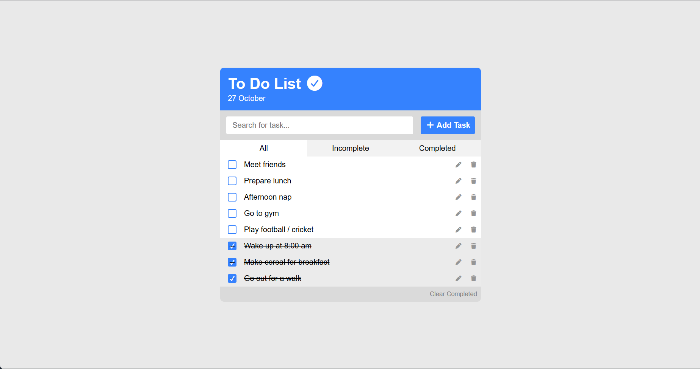
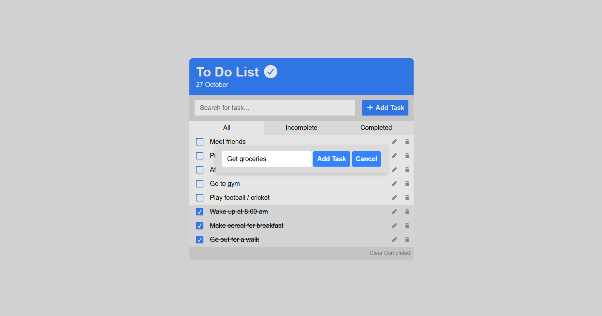
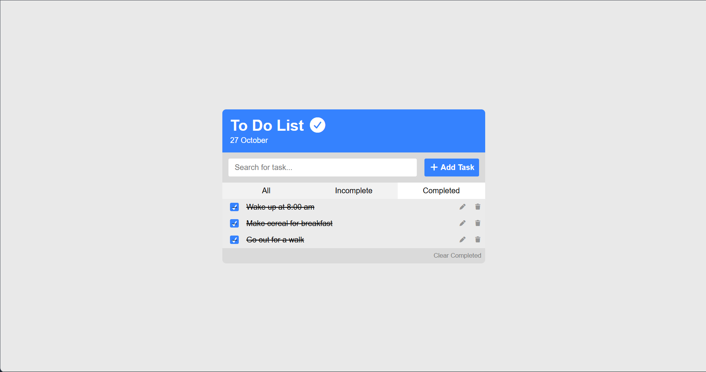

# To Do List

A lightweight to-do list that runs in the browser. Add tasks, mark them complete, search and filter the list, and keep your tasks saved between visits with browser `localStorage`.

## Project link

[Live Link](YOUR_PROJECT_LINK)

## Features

- Add tasks using the **Add Task** dialog.
- Edit or delete individual tasks.
- Mark tasks complete or incomplete with the checkbox.
- Filter the list to show all, incomplete, or completed tasks.
- Search tasks by name.
- Clear all completed tasks at once.
- Automatically save the task list in the current browser.
- Show the current date in the app header.

## Screenshots

<!-- Screenshot: Add a screenshot of the app showing the task list, search field, and filter buttons. Save it as screenshots/task-list.png. -->

<!-- Screenshot: Add a screenshot of the Add Task dialog open. Save it as screenshots/add-task.png. -->

<!-- Screenshot: Add a screenshot showing completed tasks and the Completed filter selected. Save it as screenshots/completed-tasks.png. -->

## Run locally

This project uses plain HTML, CSS, and JavaScript. It has no build step or package installation.

1. Download or clone this project.
2. Open `index.html` in a modern web browser.

Alternatively, serve the project folder with a local development server and open the provided local URL.

## Data storage

Tasks are stored in the browser's `localStorage` under the key `tasks`. They remain available in the same browser and origin after refreshing or reopening the app. Clearing the browser's site data or using a different browser/device will not carry the tasks over.

## Project files

- `index.html` — app layout, task dialogs, and Font Awesome stylesheet reference.
- `style.css` — layout, colors, task styles, and dialog styles.
- `script.js` — task creation, editing, deletion, completion, search, filters, sorting, and local storage.

Font Awesome icons are loaded from a CDN, so an internet connection is needed for those icons to appear.
